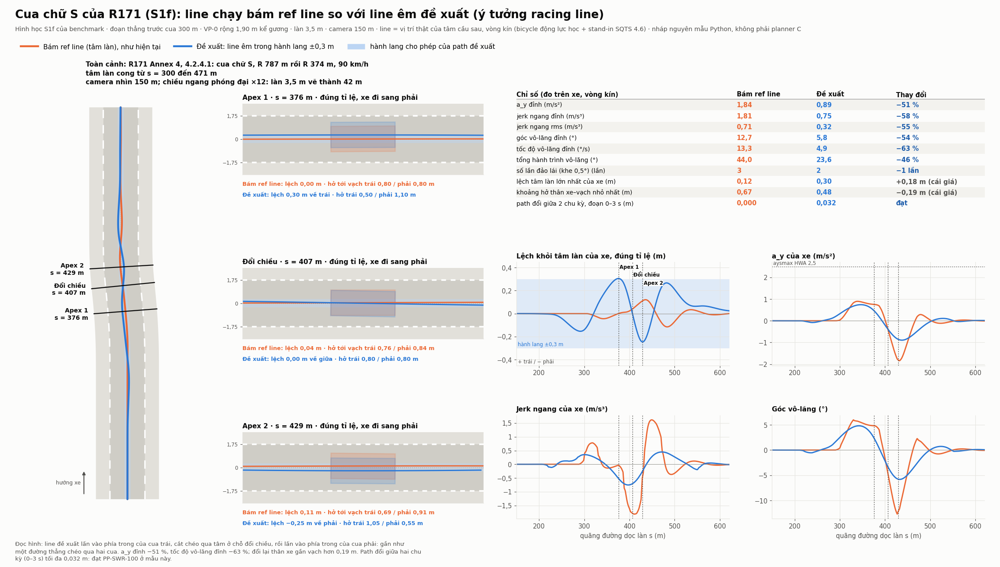

# Week 2 Mentor Report

| Field | Value |
|---|---|
| Document ID | `PP-MR` |
| Version | 1.7 |
| Status | BL1 |
| Author | thongbui |
| Reviewer |   |
| Last updated | 2026-11-16 |

## 1. Project overview {#summary-scope}

The project has integrated the C11 path planner for HWA, LKA, and ELK into the Software-in-the-Loop (SIL) test framework. Requirements and design decisions inform the build and the evaluation criteria. Benchmark failures help the team identify issues to investigate and alternatives to test. The November 15 build completed the `full` suite with a **Fail** verdict.

## 2. Technical Documents {#summary-requests}

The baseline document set describes HWA, LKA, and ELK behavior, the path planner design, and how to verify it in SIL. Shared requirement IDs link safety goals and design decisions to test cases and evaluation criteria.

| Name | Description |
|---|---|
| [ADAS Function Specification](technical-documents/?doc=adas-function-specification&lang=en) | **Scope.** Describes three lateral assistance functions, HWA, LKA, and ELK, and the respective responsibilities of the ADAS function logic and path planner.   **Intervention.** Defines when each function is available, sends or cancels a request, yields to the driver, and issues a warning. |
| [Software Requirements Specification (SRS)](technical-documents/?doc=path-planner-software-requirements-specification&lang=en) | **Requirements.** 98 active requirements across four types, with 56 Safety, 20 Functional, 14 Interface, and 8 Regulatory. Each requirement has a verification method.   **Operating scope.** Defines the ODD, 21 assumptions, and calibration limits.   **Performance.** 14 targets for measurement and comparison, including lateral deviation, jerk, and compute time. |
| [Interface Control Document (ICD)](technical-documents/?doc=path-planner-interface-control-document&lang=en) | **C API.** Specifies four functions, `pp_state_size`, `pp_init`, `pp_step`, and `pp_version`.   **Data.** Describes eight input groups and three outputs (`Trajectory`, `PathStatus`, `LateralLimits`), including field types, units, coordinate frames, timestamps, rates, and timeouts. |
| [Software Architectural Design (SAD)](technical-documents/?doc=path-planner-software-architectural-design&lang=en) | **Architecture.** Describes the 25 ms cycle, from input checks, latency compensation, and reference line construction through function arbitration, path generation and stitching, feasibility checks, and output.   **System behavior.** Describes exchanges with the longitudinal module and degradation levels for missing or invalid inputs. |
| [Software Detailed Design (SDD)](technical-documents/?doc=path-planner-software-detailed-design&lang=en) | **Algorithms.** Details 11 components, T1–T11, including reference line construction, path stitching, quintic or QP generation, and kinematic limit checks.   **Implementation.** Maps each component to its C module and documents the processing sequence, formulas, and calibration parameters. |
| [Architecture Decision Records (ADR)](technical-documents/?doc=path-planner-architecture-decision-records&lang=en) | **Scope.** 15 decision records, `PP-ADR-001` through `PP-ADR-015`, covering lateral and longitudinal separation, latency compensation, lane boundary loss, and C11 packaging.   **Record contents.** Context, alternatives considered, consequences of the choice, and related requirements. |
| [Hazard Analysis and Risk Assessment (HARA)](technical-documents/?doc=path-planner-hazard-analysis-and-risk-assessment&lang=en) | **Functional safety.** Analyzes eight hazardous events by severity, exposure, and controllability. Proposes ASIL ratings, safe states, and five safety goals.   **SOTIF.** Links 13 triggering conditions to mitigations and verification cases. |
| [Software Qualification Test Specification (SQTS)](technical-documents/?doc=path-planner-software-qualification-test-specification&lang=en) | **Test coverage.** 24 scenarios, 23 fault types, four latency and visibility sweeps, and six vehicle profiles.   **Evaluation.** Specifies open- and closed-loop testing, B0 integration checks, B1–B8 reporting groups, and pass or fail criteria by requirement. |

## 3. Framework {#summary-system}

The team built a test framework for the C11 path planner, from loading the library to reporting results by requirement. It generates cases from the suite configuration, records variants, vehicle profiles, and seeds in a manifest, then runs B0 API checks and SIL simulations. The dashboard shows the failed `PP-SWR` requirement, case, and first failure time. MCAP logs capture the timeline for failed cases. The `--planner` option lets the team swap libraries and rerun the same manifest to compare two builds on identical cases.

| Component | Implementation | Output for review |
|---|---|---|
| Interface and adapter | `interfaces/gen.py` generates C headers and Python types from a shared schema. The SIL adapter loads a `.so` or `.dylib` through `ctypes`, calls `pp_init` and `pp_step`, and converts data according to the ICD. | `pp_version()` returns the library version, source commit, and calibration ID. |
| Case generation | `eval.generate` instantiates OpenSCENARIO 1.3.1 scenarios and faults and OpenDRIVE 1.8.1 roads, then selects variants, vehicle profiles, and seeds from the suite configuration. | The manifest records case IDs, roads, variants, faults, profiles, and seeds to rerun a case or compare two libraries on the same cases. |
| Execution and scoring | `eval.run_full` orchestrates case generation, B0, SIL execution, and reporting. The evaluator scores each applicable `PP-SWR` requirement using ICD outputs and simulated vehicle motion. | `summary.json` counts completed runs, failed runs, and execution errors. The dashboard links to failed requirements, case IDs, seeds, and the first failure time. |
| Failure investigation | Each run executes in its own process. For recorded runs, the manifest captures the library identity, calibration, and configuration. | Failed cases have MCAP logs for timeline review. A case can be rerun with the `eval.runner` command recorded in its result. |

## 4. SIL {#summary-sil}

The team uses scripted vehicle motion in open loop to compare planner builds under the same inputs. Closed-loop cases keep the simulated controller, EPS, and ACC fixed across builds. The evaluator measures tire clearance from lane markings, settling time, and steering handoff on the vehicle model, and path smoothness directly on `Trajectory`.

| Simulation component | Configuration used | Case or measurement |
|---|---|---|
| Clocks and signals | The scheduler runs deterministically from a seed at a 1 ms time step. The planner runs at 40 Hz, and the lane model and object sensor sample at 20 Hz. Channels model latency, jitter, dropped or reordered messages, and counter or CRC faults. | Q1 sweeps camera latency from 0 to 300 ms. Q2 and Q3 sweep yaw-rate and ADAS request latency. Q4 varies the start and end of lane marking visibility. |
| Vehicle and lateral control | A dynamic bicycle model uses RK4 integration with lateral force limited by tire grip. The lateral controller runs at 100 Hz. The simulated EPS tracks a steering angle target with delay, angle limits, and rate limits. | S12 uses a friction coefficient of 0.5 and increased sensor noise. S13 varies EPS delay from 75 to 150 ms. |
| LKA and ELK requests | The stand-in issues `FunctionRequests` using delayed, fault-injected sensor data in mode A or ground truth in mode B. Mode B is used to score the planner. Arbitration cases can also replay a scripted request sequence. | Logs capture request timing in both modes and the time each request reaches the planner. The harness can inject a fault as soon as `PathStatus` reports `ACTIVE` or 0.2 s later. |
| ACC coordination | The simulated ACC reads `LateralLimits` to slow down before a curve, then sends a `LongitudinalPlan` containing predicted speed and acceleration over 3 s. | S14 runs with ACC using or ignoring the lateral limits to show how slowing down affects lane keeping. |

Profiles VP-0 through VP-5 use the same build and calibration. VP-5 is a synthetic profile 2.5 m wide including mirrors. The closed-loop measurements in this report use the vehicle and EPS models described above.

## 5. Path Planner {#summary-design}

The C11 planner serves all three functions on a 25 ms cycle. The design covers roads with lane markings or edges, lane widths of 2.5–5.5 m, and vehicles up to 2.5 m wide including mirrors. It reads vehicle-specific parameters from `VehicleConfig`. Calibration is compiled into the library.

| Stage | Implementation | Behavior for review |
|---|---|---|
| Input and reference line | Compensates for latency from the camera capture timestamp using ego-motion. Checks lane boundary consistency and fuses camera curvature with yaw rate and historical estimates. | With one missing line, it uses the other line and the remembered lane width. With both ego-lane lines missing, HWA can infer the center from another boundary.   With no reliable boundary, it reuses the previous path for up to 1 s and then marks the path invalid. |
| Function arbitration | Prioritizes ELK, then LKA, then HWA. Maintains separate LKA and ELK phases so the ADAS logic can tell when an intervention starts or ends. | S9 tests handovers between functions. During driver override, the planner starts the path from the measured vehicle state. |
| Path generation | The `full` build used quintic generation for all three functions. HWA holds or returns to lane center and can offset the path to increase clearance from a large vehicle. A build-time QP option for HWA supports comparisons. | The offset depends on the clearance shortfall and available space in the lane. PP-TS-003 records the generator selection and processing order. |
| Stitching and feasibility | T4 transforms the previous path into the current vehicle frame and limits the step between paths. For HWA, T10 limits the candidate before T4 and rechecks the outgoing path against lateral acceleration, jerk, and steering limits. | SRS 1.22 defines continuity limits for three time segments. T4 currently uses one blend factor based on the 0–1 s limits. PP-TS-019 considers separate factors by segment. |
| Outputs | `Trajectory` has 31 points over 3 s and an `observed_horizon_s` marker.   `PathStatus` reports validity, function, intervention phase, and limit flags.   `LateralLimits` reports `v_max` and distance to the point of highest curvature. | The lateral controller uses the trajectory and status to track the path. The longitudinal module uses `v_max` to plan braking before a curve. |

Path lateral acceleration limits for HWA, LKA, and ELK are 2.5, 3.0, and 4.0 m/s² respectively. The corresponding lateral jerk limits are 5, 5, and 10 m/s³. If a curve demands more lateral acceleration than HWA can provide, the project requires HWA to continue assisting within its limits, set the limit flag when its conditions are met, and provide a speed limit for the longitudinal module to slow down before the curve.

## 6. Benchmark {#summary-verification}

The November 15 `full` run on commit `7495822` with calibration `d532993b1b2f` completed **3,958 runs across six vehicle profiles**. Of those, **298 runs failed in-scope criteria**, with **zero execution errors**. Blocker failures gave the run a **Fail** verdict. [Benchmark dashboard](benchmark/?lang=en) · [Run record](https://github.com/thongbuind/Path-planning-for-the-L2-lateral-feature/blob/main/research/runs/20261115-1126-suite-full-7495822/report.md)

| Group | What it checks | Results or measurements from the run |
|---|---|---|
| B0 Conformance | C API and contract, determinism, interleaved instances, and state buffer boundaries. | **Integrable in SIL.** 19 checks passed. Two instances produced bit-identical results over 400 cycles, including interleaved execution.   State memory was 40,664 bytes. `C1.layout` could not verify the struct layout because the library did not expose a schema version. |
| B1 Nominal | Behavior in nominal conditions, within the ODD and without injected faults. | **1,533 of 1,537 runs passed in scope**, with 4 failed runs and 6 blocker violations. All runs passed in 21 of 24 scenario groups.   Two S16(d) runs had an ELK request with no valid intervention path. The other failures were in S5(a) and S13(b) ELK. |
| B2 Regulatory | Simulated test grids based on R79, R171, EU ELKS, and Euro NCAP within planner scope. | **595 of 618 runs passed**, and **10 of 11 simulated tests passed**. There were 33 blocker and 7 minor violations.   The R171 lane position test passed 97 of 120 runs. S14(e) accounted for 12 failed runs, with the remaining failures in F21 lane marking loss cases. R79, EU ELKS, and Euro NCAP passed 4 of 4, 2 of 2, and 4 of 4 applicable tests respectively. |
| B3 Performance limit | Behavior at the edges of the ODD or when curvature and speed demand more lateral acceleration than the function can provide. | **612 of 675 runs passed**, with 63 failed runs, 150 blocker violations, and 3 minor violations.   S14 accounted for 42 failed runs and S1b for 15. The most frequent violation was excess lateral deviation between successive paths (`PP-SWR-100`, 52 runs). |
| B4 Robustness | Behavior under sensor, communication timing, or signal integrity faults, including combined faults. | **1,515 of 1,746 runs passed**, with 231 failed runs, 106 blocker violations, and 138 minor violations.   Completion timing failed in 130 runs (`PP-SWR-032`) and HWA lane keeping in 78 (`PP-SWR-051`). The G01 combined night-and-rain fault failed in 67 of 120 runs. |
| B5 Degradation and refusal | Decisions to continue with limits, degrade, or refuse assistance. Checks both missed and excessive refusals. | **540 of 601 runs passed**, with 61 failed runs and 150 blocker violations.   In curves that exceeded HWA authority, 12 of 121 applicable runs failed to retain HWA or a valid path (`PP-SWR-005`). The limit flag came on late in 8 of 113 applicable runs (`PP-SWR-007`). |
| B6 Comfort | Lateral jerk, added lateral acceleration, and steering activity in nominal cases. | **1,537 runs in Comfort.** In 93 S2 runs, median recentering time was 2.353 s and the longest was 3.663 s.   S17 reached a lateral jerk RMS of 1.011 m/s³ over the first second of the path and added lateral acceleration of 2.215 m/s². These metrics are measured and ranked. |
| B7 Flexibility | The same library and calibration across six profiles, with results by requirement and metric. | **1,404 of 1,470 runs passed**, with 66 failed runs. `PP-SWR-051` failed most often, in 38 runs.   Requirement pass rates for VP-0, VP-1, and VP-2 were 83.3%, 90.3%, and 96.8%. Rates for VP-3, VP-4, and VP-5 were 90.0%, 93.3%, and 84.4%. |
| B8 Compute | Per-cycle duration on the SIL host, including the adapter. | **3,502,333 cycles** across 3,958 runs. Histogram upper bounds were ≤ 1 ms at the median, ≤ 2 ms at p95, and ≤ 3.162 ms at p99.   2,256 cycles exceeded 25.12 ms (0.06%). The longest sample was 2,443 ms in S15(b), VP-4. |

The most frequent failures were **PP-SWR-032** for `COMPLETED` timing (131), **PP-SWR-051** for staying in lane when HWA was active and the test conditions applied (96), and **PP-SWR-100** for lateral deviation between successive paths (61). A run can appear in several groups and fail multiple requirements. This run predates SRS 1.22 and SQTS 1.44, so the continuity results use the November 15 criteria.

## 7. Research {#summary-research}

The team uses the research register to track issues found in SIL and retain the evidence behind design decisions. [Research register](https://github.com/thongbuind/Path-planning-for-the-L2-lateral-feature/blob/main/research/register.md)

- **Problem Report (PR, `PP-PR`).** 55 records describe the observed behavior, the run ID, case, and seed needed to reproduce it, and the affected requirements. When analysis or regression results are available, the team records the cause and the run that verified the fix.
- **Trade Study (TS, `PP-TS`).** 19 records describe the design question, alternatives, and evaluation criteria. Run results inform the choice of alternative and any resulting changes to requirements, design, or calibration.

### PP-TS-013 The S1(f) S-curve {#comfort-path-study}

**Concept.** Before entering each bend, the vehicle shifts slightly toward the outside of the bend. It then moves gradually toward the inside to follow a gentler arc. The path uses a corridor within ±0.30 m of the lane centerline to increase the turning radius and reduce peak curvature compared with centerline tracking.

**On the simulated vehicle, the proposed path cut peak lateral acceleration by 51%, peak lateral jerk by 58%, and peak steering wheel rate by 63%** compared with tracking the lane centerline. The result comes from the closed-loop Python prototype on the R171 S1(f) S-curve.

The case uses VP-0 at 90 km/h in a 3.5 m lane with arc radii of 787 m and 374 m and a 150 m research visibility range. The blue line shows the vehicle tracking the proposed path, and the orange line shows it tracking the centerline.

| Closed-loop metric | Centerline tracking | Proposed path | Change |
|---|---|---|---|
| Peak lateral acceleration | 1.84 m/s² | 0.89 m/s² | −51% |
| Peak lateral jerk | 1.81 m/s³ | 0.75 m/s³ | −58% |
| Peak steering wheel rate | 13.3°/s | 4.9°/s | −63% |
| Minimum clearance from vehicle body to lane marking | 0.67 m | 0.48 m | −0.19 m |

In the prototype visibility sweep, the change between successive paths grew from 32 mm at 150 m to 129 mm at the nominal SIL range of 80 m. The next research step is to check smoothness, clearance, and continuity at nominal visibility with noisy lane model data. The current C quintic remains the baseline. [PP-TS-013 record](https://github.com/thongbuind/Path-planning-for-the-L2-lateral-feature/blob/main/research/studies/PP-TS-013-comfort-line/study.md)

## Revision history {#revision-history}

| Version | Date | Changes |
|---|---|---|
| 1.0 | 2026-11-10 | Rewritten as the Technical Summary for the BL1 technical document set |
| 1.1 | 2026-11-11 | Updated the lateral offset to follow the revised PP-ADR-008 |
| 1.2 | 2026-11-12 | Scoped path continuity to the observation range and added `observed_horizon_s` to Trajectory |
| 1.3 | 2026-11-13 | Added PP-ADR-013 through 015 and updated the requirement, fault, and sweep counts, suite sizes, and verdict rules |
| 1.4 | 2026-11-13 | Updated the UN R79 entry to describe the warning at 10 s and continued LKA/ELK intervention (PP-TS-016) |
| 1.5 | 2026-11-16 | Updated the continuity limits to 0.2 m, 0.02 rad, and 0.0012 1/m following mentor feedback (SRS 1.21) |
| 1.6 | 2026-11-16 | Added continuity limits for three path segments (SRS 1.22) |
| 1.7 | 2026-11-16 | Rewrote the report for the week 2 review with implementation details and SIL results, separated Benchmark, and illustrated PP-TS-013 with the S1(f) S-curve |
