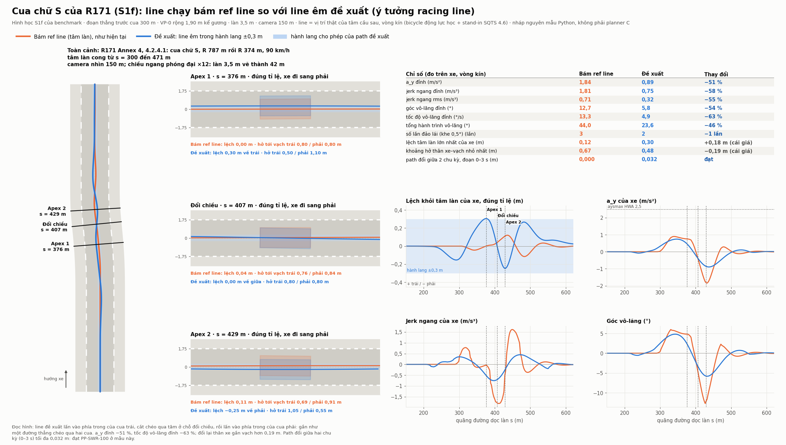

# Mentor Report tuần 2

| Mục | Nội dung |
|---|---|
| Mã tài liệu | `PP-MR` |
| Phiên bản | 1.7 |
| Trạng thái | BL1 |
| Tác giả | thongbui |
| Người review |   |
| Cập nhật | 2026-11-16 |

## 1. Tổng quan {#summary-scope}

Dự án đã tích hợp path planner C11 cho HWA, LKA và ELK vào framework kiểm thử Software-in-the-Loop (SIL). Yêu cầu và quyết định thiết kế đi vào bản build và tiêu chí chấm. Các ca trượt từ benchmark giúp nhóm chọn vấn đề cần phân tích và phương án cần thử. Bản build ngày 15/11 chạy `full benchmark` với kết luận **Chưa đạt**.

## 2. Technical Documents {#summary-requests}

Bộ tài liệu baseline mô tả hành vi của HWA, LKA và ELK, thiết kế path planner và cách kiểm chứng trong SIL. Mã yêu cầu dùng chung giúp truy vết từ mục tiêu an toàn và quyết định thiết kế đến ca thử và tiêu chí chấm.

| Tên | Mô tả |
|---|---|
| [ADAS Function Specification](technical-documents/?doc=adas-function-specification&lang=vi) | **Phạm vi.** Mô tả 3 chức năng hỗ trợ lái ngang HWA, LKA và ELK, cùng phần việc của khối ADAS và path planner.   **Điều kiện can thiệp.** Xác định khi nào chức năng khả dụng, gửi hoặc hủy yêu cầu, nhường quyền cho tài xế và phát cảnh báo. |
| [Software Requirements Specification (SRS)](technical-documents/?doc=path-planner-software-requirements-specification&lang=vi) | **Yêu cầu.** 98 yêu cầu thuộc 4 nhóm, gồm 56 Safety, 20 Functional, 14 Interface và 8 Regulatory. Mỗi yêu cầu có phương pháp kiểm chứng.   **Phạm vi vận hành.** Xác định ODD, 21 giả định và giới hạn calibration.   **Hiệu năng.** 14 chỉ tiêu để đo và so sánh, gồm sai lệch ngang, jerk và thời gian tính. |
| [Interface Control Document (ICD)](technical-documents/?doc=path-planner-interface-control-document&lang=vi) | **C API.** Quy định 4 hàm `pp_state_size`, `pp_init`, `pp_step` và `pp_version`.   **Dữ liệu.** Mô tả 8 nhóm đầu vào và 3 đầu ra (`Trajectory`, `PathStatus`, `LateralLimits`), gồm kiểu trường, đơn vị, hệ tọa độ, timestamp, tần số và timeout. |
| [Software Architectural Design (SAD)](technical-documents/?doc=path-planner-software-architectural-design&lang=vi) | **Kiến trúc.** Mô tả luồng xử lý mỗi 25 ms, từ kiểm tra đầu vào, bù trễ và dựng đường tham chiếu đến Arbitration, sinh và nối path, kiểm tính khả thi rồi xuất kết quả.   **Hành vi hệ thống.** Mô tả trao đổi với khối dọc và các mức suy giảm khi đầu vào thiếu hoặc không hợp lệ. |
| [Software Detailed Design (SDD)](technical-documents/?doc=path-planner-software-detailed-design&lang=vi) | **Thuật toán.** Chi tiết 11 khối T1–T11, gồm dựng đường tham chiếu, nối path, sinh path quintic hoặc QP và kiểm giới hạn động học.   **Triển khai.** Ánh xạ từng khối sang module C, ghi trình tự xử lý, công thức và tham số calibration. |
| [Architecture Decision Records (ADR)](technical-documents/?doc=path-planner-architecture-decision-records&lang=vi) | **Phạm vi.** 15 hồ sơ quyết định từ `PP-ADR-001` đến `PP-ADR-015`, gồm tách khối ngang và dọc, bù trễ, xử lý mất biên và đóng gói planner C11.   **Nội dung mỗi hồ sơ.** Bối cảnh, các phương án đã cân nhắc, hệ quả của lựa chọn và yêu cầu liên quan. |
| [Hazard Analysis and Risk Assessment (HARA)](technical-documents/?doc=path-planner-hazard-analysis-and-risk-assessment&lang=vi) | **An toàn chức năng.** Phân tích 8 sự kiện nguy hiểm theo mức độ nghiêm trọng, mức phơi nhiễm và khả năng kiểm soát. Đề xuất ASIL, trạng thái an toàn và 5 mục tiêu an toàn.   **SOTIF.** Liên kết 13 điều kiện kích hoạt với biện pháp xử lý và ca kiểm chứng. |
| [Software Qualification Test Specification (SQTS)](technical-documents/?doc=path-planner-software-qualification-test-specification&lang=vi) | **Phạm vi kiểm thử.** 24 kịch bản, 23 loại lỗi đưa vào mô phỏng, 4 phép quét độ trễ và tầm nhìn, 6 cấu hình xe.   **Cách đánh giá.** Quy định khi nào chạy vòng hở hoặc vòng kín, cách kiểm tích hợp B0, cách nhóm kết quả B1–B8 và tiêu chí đạt hoặc trượt theo requirement. |

## 3. Framework {#summary-system}

Nhóm đã xây dựng framework kiểm thử path planner C11 từ khâu nạp thư viện đến báo cáo theo từng yêu cầu. Framework sinh ca từ cấu hình suite, ghi biến thể, profile xe và seed vào manifest, rồi kiểm API bằng B0 và chạy SIL. Dashboard chỉ ra mã `PP-SWR`, ca và thời điểm trượt đầu tiên. Log MCAP giúp xem lại diễn biến của ca trượt. Có thể thay thư viện qua `--planner` và chạy lại cùng manifest để so sánh hai bản build trên cùng bộ ca.

| Thành phần | Đã triển khai | Đầu ra dùng khi review |
|---|---|---|
| Interface và adapter | `interfaces/gen.py` sinh header C và kiểu Python từ schema dùng chung. Adapter SIL nạp `.so` hoặc `.dylib` qua `ctypes`, gọi `pp_init` và `pp_step`, rồi chuyển dữ liệu theo ICD. | `pp_version()` trả phiên bản, commit và mã calibration của thư viện đang chạy. |
| Sinh ca | `eval.generate` cụ thể hóa kịch bản và lỗi OpenSCENARIO 1.3.1, đường OpenDRIVE 1.8.1, rồi chọn biến thể, cấu hình xe và seed theo suite. | Manifest giữ mã ca, đường, biến thể, lỗi, profile và seed để chạy lại đúng ca hoặc so hai thư viện trên cùng bộ ca. |
| Chạy và chấm | `eval.run_full` gọi bộ sinh ca, B0, bộ chạy SIL và bộ xuất báo cáo. Chấm theo mã `PP-SWR` từ output ICD và chuyển động xe trong mô phỏng. | `summary.json` cho biết số lượt chạy, trượt và lỗi thực thi. Dashboard dẫn vào requirement trượt, ca, seed và thời điểm trượt đầu tiên. |
| Điều tra ca trượt | Mỗi lượt chạy trong tiến trình riêng. Với lần chạy chính thức, manifest lưu định danh thư viện, calibration và cấu hình đã dùng. | Ca trượt có log MCAP để đọc lại timeline. Có thể chạy riêng một ca bằng `eval.runner` theo lệnh ghi trong hồ sơ. |

## 4. Software In the Loop (SIL) {#summary-sil}

Dùng chuyển động xe định sẵn ở vòng hở để so các bản planner trên cùng điều kiện đầu vào. Ở vòng kín, controller, EPS và ACC giả lập được giữ cố định giữa các bản build. Bên chấm đo khoảng cách lốp tới vạch, thời điểm ổn định và phản ứng khi bàn giao trên mô hình xe, còn độ êm của path được đo trực tiếp trên `Trajectory`.

| Phần mô phỏng | Cấu hình đã dùng | Ca hoặc phép đo |
|---|---|---|
| Đồng hồ và tín hiệu | Bộ lập lịch tất định theo seed, bước 1 ms. Planner chạy 40 Hz, lane model và vật thể lấy mẫu 20 Hz. Kênh mô phỏng trễ, jitter, mất hoặc đảo thứ tự message và lỗi counter/CRC. | Q1 quét trễ camera 0–300 ms. Q2 và Q3 quét trễ yaw rate và yêu cầu ADAS. Q4 thay điểm đầu và cuối tầm nhìn của vạch. |
| Mô hình xe và điều khiển ngang | Bicycle động lực học, tích phân RK4, giới hạn lực ngang theo độ bám. Bộ điều khiển ngang chạy 100 Hz. EPS giả lập nhận góc lái, có trễ và giới hạn góc, tốc độ quay. | S12 dùng hệ số bám 0,5 và tăng nhiễu cảm biến. S13 thay trễ EPS từ 75 đến 150 ms. |
| Yêu cầu LKA và ELK | Stand-in phát `FunctionRequests` từ dữ liệu cảm biến sau trễ và lỗi ở chế độ A, hoặc từ ground truth ở chế độ B. Chế độ B dùng để chấm planner. Ca arbitration có thể phát chuỗi yêu cầu định sẵn. | Ghi thời điểm yêu cầu ở A và B cùng thời điểm planner thực nhận. Với lỗi theo sự kiện, harness có thể bơm ngay khi `PathStatus` báo `ACTIVE` hoặc 0,2 s sau đó. |
| Phối hợp với ACC | ACC giả lập đọc `LateralLimits` để giảm tốc trước cua, rồi gửi lại `LongitudinalPlan` gồm tốc độ và gia tốc dự kiến trong 3 s. | S14 chạy hai biến thể với ACC dùng hoặc bỏ qua giới hạn ngang, để quan sát tác động của giảm tốc lên khả năng giữ làn. |

Sáu cấu hình VP-0 đến VP-5 dùng cùng bản build và bộ calibration. VP-5 là cấu hình tổng hợp rộng 2,5 m kể cả gương. Các số đo vòng kín trong báo cáo dựa trên mô hình xe và EPS giả lập ở trên.

## 5. Path Planner {#summary-design}

Planner C11 phục vụ cả ba chức năng với chu kỳ 25 ms. Phạm vi thiết kế bao gồm đường có vạch hoặc mép đường, làn rộng 2,5–5,5 m và xe rộng tới 2,5 m kể cả gương. Thông số riêng của xe lấy từ `VehicleConfig`. Calibration được biên dịch vào thư viện.

| Khâu | Đã triển khai | Hành vi cần review |
|---|---|---|
| Đầu vào và đường tham chiếu | Bù trễ theo timestamp chụp bằng ego-motion. Kiểm tính nhất quán của biên làn và kết hợp độ cong camera với yaw rate và lịch sử. | Mất một vạch thì dùng biên còn lại và bề rộng đã nhớ. Mất cả hai vạch làn mình thì HWA có thể suy tâm từ biên khác.   Nếu mất mọi biên đủ tin, bám path cũ tối đa 1 s rồi báo path không hợp lệ. |
| Điều phối chức năng | Xét yêu cầu theo ưu tiên ELK → LKA → HWA. Quản lý pha LKA và ELK riêng để khối ADAS biết can thiệp đã bắt đầu hay kết thúc. | Ca S9 kiểm chuyển quyền giữa các chức năng. Khi tài xế ghi đè, planner dùng trạng thái xe đo được làm điểm bắt đầu path. |
| Sinh path | Bản `full` dùng quintic cho cả ba chức năng. HWA giữ hoặc đưa xe về tâm và có thể dời khỏi tâm để tăng khoảng hở với xe lớn. Nhánh QP cho HWA chọn lúc build để so sánh. | Dời tâm phụ thuộc khoảng hở còn thiếu và khoảng trống thực trong làn. Kết quả chọn quintic và thứ tự xử lý nằm ở PP-TS-003. |
| Nối path và kiểm giới hạn | T4 đưa path cũ về hệ tọa độ xe hiện tại rồi giới hạn bước thay đổi. Với HWA, T10 giới hạn path ứng viên trước T4 và kiểm lại path gửi đi theo gia tốc ngang, jerk và giới hạn lái. | SRS 1.22 chia ngưỡng continuity theo ba đoạn thời gian. T4 hiện dùng một hệ số trộn theo ngưỡng đoạn 0–1 s. Trộn riêng từng đoạn đang được xét ở PP-TS-019. |
| Đầu ra | `Trajectory` có 31 điểm trong 3 s và mốc `observed_horizon_s`.   `PathStatus` báo tính hợp lệ, chức năng, pha can thiệp và cờ giới hạn.   `LateralLimits` báo `v_max` và khoảng cách tới điểm cong nhất. | Controller dùng quỹ đạo và trạng thái để bám path. Khối dọc dùng `v_max` để tính mức giảm tốc trước cua. |

Giới hạn gia tốc ngang trên path của HWA, LKA và ELK lần lượt là 2,5 / 3,0 / 4,0 m/s². Giới hạn jerk ngang tương ứng là 5 / 5 / 10 m/s³. Khi cua đòi gia tốc ngang vượt giới hạn HWA, yêu cầu của dự án là tiếp tục hỗ trợ trong khả năng, bật cờ khi tới điều kiện giới hạn và gửi tốc độ cho khối dọc giảm trước cua.

## 6. Benchmark {#summary-verification}

Lần `full` ngày 15/11, hoàn tất **3.958 lượt trên 6 cấu hình xe**. Có **298 lượt trượt tiêu chí trong phạm vi chấm** và **0 lỗi thực thi**. Kết luận của lần chạy là **Chưa đạt**.

| Bộ | Chấm gì | Kết quả / số đo trong lần chạy |
|---|---|---|
| B0 Conformance | API và contract C, tính tất định, chạy xen kẽ hai instance và giới hạn vùng nhớ. | **Tích hợp được vào SIL.** 19 phép kiểm đạt. Hai instance cho kết quả giống từng bit trên 400 chu kỳ, kể cả khi chạy xen kẽ.   Vùng nhớ trạng thái là 40.664 byte. Thư viện chưa có thông tin phiên bản schema để đối chiếu layout struct ở `C1.layout`. |
| B1 Nominal | Hành vi trong điều kiện danh định, trong ODD và không bơm lỗi. | **1.533/1.537 lượt đạt trong phạm vi chấm**, 4 lượt trượt với 6 vi phạm BLOCKER. Có 21/24 nhóm tình huống đạt toàn bộ.   Hai lượt S16(d) có yêu cầu ELK nhưng thiếu path can thiệp hợp lệ. Hai lượt còn lại thuộc S5(a) và S13(b) ELK. |
| B2 Regulatory | Lưới ca mô phỏng theo R79, R171, EU ELKS và Euro NCAP trong phạm vi planner. | **595/618 lượt đạt** và **10/11 bài thử mô phỏng đạt**. Có 33 vi phạm BLOCKER và 7 MINOR.   Bài vị trí trong làn theo R171 đạt 97/120 lượt, với 12 lượt trượt ở S14(e) và các lượt trượt còn lại ở F21. R79, EU ELKS và Euro NCAP lần lượt đạt 4/4, 2/2 và 4/4 bài thử áp dụng. |
| B3 Performance limit | Phản ứng ở biên ODD hoặc khi độ cong và tốc độ đòi gia tốc ngang vượt quyền lái. | **612/675 lượt đạt**, 63 lượt trượt với 150 vi phạm BLOCKER và 3 MINOR.   S14 có 42 lượt trượt và S1b có 15. Vi phạm thường gặp nhất là lệch ngang giữa hai path liên tiếp vượt ngưỡng (`PP-SWR-100`, 52 lượt). |
| B4 Robustness | Hành vi khi có lỗi cảm biến, thời gian truyền hoặc tính toàn vẹn của tín hiệu, gồm cả ca ghép lỗi. | **1.515/1.746 lượt đạt**, 231 lượt trượt với 106 vi phạm BLOCKER và 138 MINOR.   Báo `COMPLETED` sai thời điểm xuất hiện ở 130 lượt (`PP-SWR-032`), còn giữ làn HWA trượt ở 78 lượt (`PP-SWR-051`). Ca ghép lỗi mưa đêm G01 có 67/120 lượt trượt. |
| B5 Degradation and refusal | Quyết định tiếp tục lái có giới hạn, suy giảm hoặc từ chối. Chấm cả từ chối thiếu và từ chối thừa. | **540/601 lượt đạt**, 61 lượt trượt với 150 vi phạm BLOCKER.   Khi cua vượt giới hạn HWA, 12/121 lượt không giữ được chức năng hoặc path hợp lệ (`PP-SWR-005`). Ở phép kiểm cờ giới hạn có 8/113 lượt bật cờ quá muộn (`PP-SWR-007`). |
| B6 Comfort | Đo độ êm trên nhóm ca danh định, gồm jerk ngang, gia tốc ngang thêm vào và thao tác lái ở vòng kín. | **1.537 lượt trong bộ Comfort.** Với S2, thời gian đưa xe về tâm có trung vị 2,353 s và cao nhất 3,663 s trên 93 lượt.   S17 ghi nhận jerk ngang RMS trên đoạn 0–1 s tới 1,011 m/s³ và gia tốc ngang thêm vào tới 2,215 m/s². Đây là các chỉ số đo và xếp hạng. |
| B7 Flexibility | Cùng thư viện và calibration trên sáu profile, thống kê theo requirement và theo chỉ số. | **1.404/1.470 lượt đạt**, 66 lượt trượt. `PP-SWR-051` trượt nhiều nhất với 38 lượt.   Tỷ lệ đạt theo mã requirement trên VP-0, VP-1 và VP-2 lần lượt là 83,3%, 90,3% và 96,8%. Trên VP-3, VP-4 và VP-5 lần lượt là 90,0%, 93,3% và 84,4%. |
| B8 Compute | Đo thời gian mỗi chu kỳ trên máy chạy SIL, gồm adapter. | **3.502.333 chu kỳ** từ 3.958 lượt. Theo các khoảng thống kê, trung vị ≤ 1 ms, p95 ≤ 2 ms và p99 ≤ 3,162 ms.   Có 2.256 chu kỳ vượt 25,12 ms (0,06%). Mẫu chậm nhất là 2.443 ms ở S15(b), VP-4. |

Ba mã có nhiều lượt trượt nhất là **PP-SWR-032** về thời điểm báo `COMPLETED` (131), **PP-SWR-051** về giữ xe trong làn khi HWA đang lái và đủ điều kiện (96), và **PP-SWR-100** về lệch ngang giữa hai path liên tiếp (61). Một lượt có thể thuộc nhiều bộ và trượt nhiều mã.

## 7. Research {#summary-research}

Dùng Research register để theo dõi vấn đề phát hiện khi chạy SIL và lưu căn cứ cho các quyết định thiết kế. [Research register](https://github.com/thongbuind/Path-planning-for-the-L2-lateral-feature/blob/main/research/register.md)

- **Problem Report (PR, `PP-PR`).** 55 hồ sơ ghi hiện tượng, run ID, ca và seed để tái hiện, cùng yêu cầu bị ảnh hưởng. Khi có kết quả phân tích hoặc hồi quy, nhóm ghi lại nguyên nhân và lần chạy xác nhận bản sửa.
- **Trade Study (TS, `PP-TS`).** 19 hồ sơ ghi câu hỏi thiết kế, các phương án và tiêu chí đánh giá. Kết quả chạy là căn cứ để chọn phương án và cập nhật yêu cầu, thiết kế hoặc calibration khi có quyết định.

### PP-TS-013 Cua chữ S S1(f) {#comfort-path-study}

**Ý tưởng.** Trước khi vào mỗi khúc cua, xe dịch nhẹ về phía ngoài cua. Khi vào cua, xe chuyển dần về phía trong để đi theo một cung thoải hơn. Quỹ đạo tận dụng hành lang ±0,30 m quanh tâm làn để tăng bán kính vòng cua và giảm độ cong đỉnh so với bám tâm làn.

**Trên xe mô phỏng, quỹ đạo đề xuất giảm 51% đỉnh gia tốc ngang, 58% đỉnh jerk ngang và 63% tốc độ quay vô lăng đỉnh** so với bám đường tâm làn. Kết quả lấy từ nguyên mẫu Python vòng kín trên cua chữ S S1(f) của R171.

Ca thử dùng VP-0 ở 90 km/h, làn 3,5 m, hai cung bán kính 787 m và 374 m, với tầm nhìn nghiên cứu 150 m. Đường xanh là vệt xe bám quỹ đạo đề xuất, đường cam là vệt xe bám tâm làn.

| Số đo vòng kín | Bám tâm làn | Quỹ đạo đề xuất | Thay đổi |
|---|---|---|---|
| Đỉnh gia tốc ngang | 1,84 m/s² | 0,89 m/s² | −51% |
| Đỉnh jerk ngang | 1,81 m/s³ | 0,75 m/s³ | −58% |
| Tốc độ quay vô lăng đỉnh | 13,3°/s | 4,9°/s | −63% |
| Khoảng hở nhỏ nhất từ thân xe đến vạch | 0,67 m | 0,48 m | −0,19 m |

Trong phép quét tầm nhìn của nguyên mẫu, mức thay đổi path giữa hai chu kỳ tăng từ 32 mm ở 150 m lên 129 mm ở 80 m, mức danh định của SIL. Bước tiếp theo của nghiên cứu là kiểm lại độ êm, khoảng hở và continuity với tầm nhìn danh định và dữ liệu lane model có nhiễu. Quintic C hiện tại vẫn là mốc so sánh. [Hồ sơ PP-TS-013](https://github.com/thongbuind/Path-planning-for-the-L2-lateral-feature/blob/main/research/studies/PP-TS-013-comfort-line/study.md)

## Lịch sử sửa đổi {#revision-history}

| Phiên bản | Ngày | Nội dung |
|---|---|---|
| 1.0 | 2026-11-10 | Viết lại thành Technical Summary cho bộ tài liệu kỹ thuật BL1 |
| 1.1 | 2026-11-11 | Dời tâm theo PP-ADR-008 mới |
| 1.2 | 2026-11-12 | Liên tục giữa hai path chỉ xét phần trong tầm nhìn; Trajectory thêm `observed_horizon_s` |
| 1.3 | 2026-11-13 | Thêm PP-ADR-013 đến 015; cập nhật số requirement, lỗi, quét; thêm cỡ bộ chạy và cách kết luận |
| 1.4 | 2026-11-13 | Dòng UN R79: LKA, ELK không cắt ở 10 s, chỉ cảnh báo (PP-TS-016) |
| 1.5 | 2026-11-16 | Dòng Đề bài: ngưỡng liên tục nới theo mentor thành 0,2 m, 0,02 rad, 0,0012 1/m (SRS 1.21) |
| 1.6 | 2026-11-16 | Dòng Mentor: ngưỡng liên tục theo ba đoạn (SRS 1.22) |
| 1.7 | 2026-11-16 | Viết lại report cho tuần 2 |
